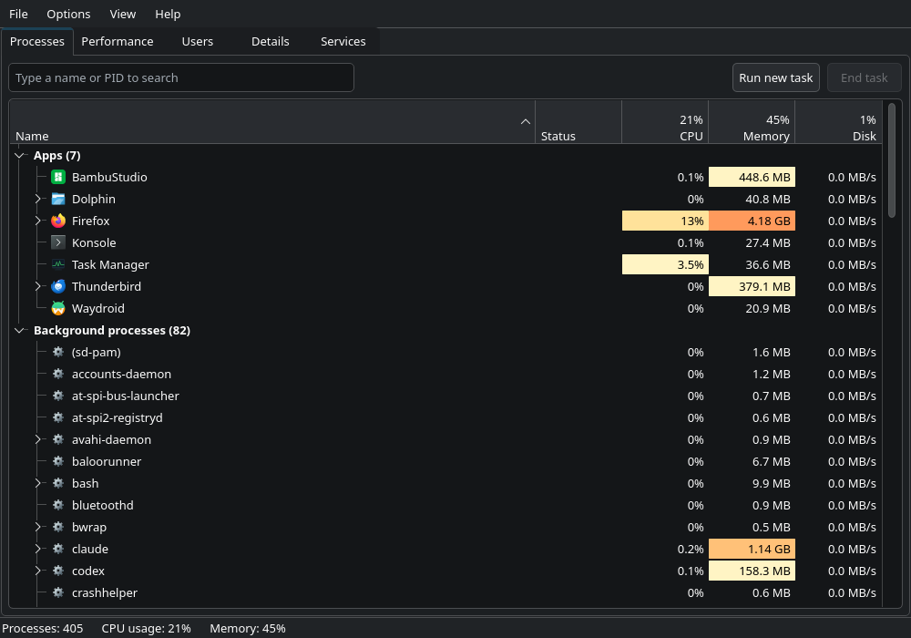
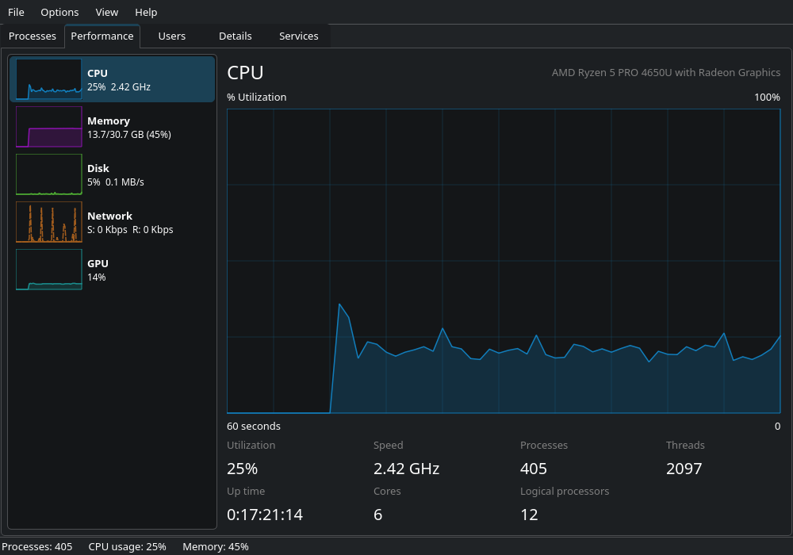
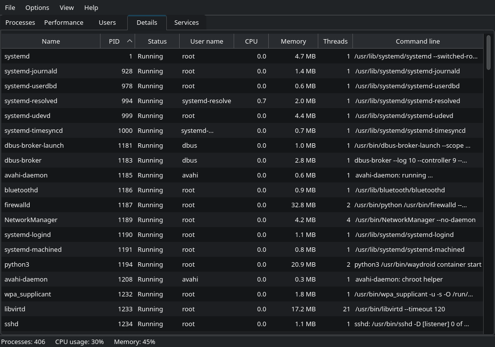
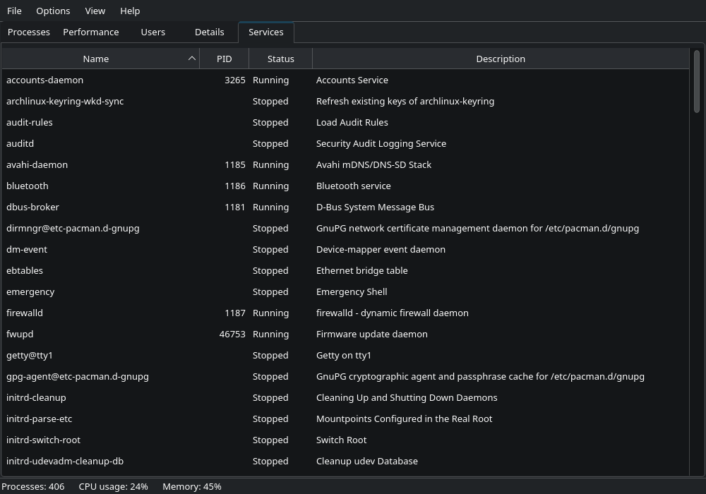

<div align="center">


# Task Manager for Linux

**The Windows Task Manager you miss, as a native Linux app.**
Processes grouped into Apps and Background, live performance graphs, users, details and systemd services, in one window.

[](https://github.com/1ewisd/linux-task-manager/actions/workflows/ci.yml)




</div>

## Why

Linux has plenty of system monitors, but none of them feel like the Windows Task Manager: the one-glance
"what is eating my RAM?" view where Firefox is a single row you can expand, the busiest things glow orange, and
**End task** is one click away. This is that, built with Qt so it looks at home on KDE, GNOME and anything else.

## Features

**Processes**
- Split into **Apps** and **Background processes**; multi-process apps (Firefox, Thunderbird, Dolphin...) collapse into one row you can expand.
- App names and icons come from your installed `.desktop` files.
- Windows-style **heat map** on CPU, Memory and Disk, with live totals in the column headers.
- Search by name, PID or command line. Sort any column.
- **End task**, **Force kill**, **Suspend / Resume**, open file location, copy command line, jump to Details.
- If a signal is denied (root-owned process), offers to retry through `pkexec`.

**Performance**
- Scrolling 60-second graphs for **CPU, Memory, Disk, Network** and **GPU** (AMD via sysfs).
- CPU speed, threads, uptime, cores; memory in use / cached / swap; disk active time and read/write rate; network send/receive.

**Users, Details, Services**
- **Users**: per-user process count, CPU and memory.
- **Details**: every process in a flat sortable table (PID, status, user, CPU, memory, threads, command line).
- **Services**: systemd services with Running / Stopped / Failed state and Start / Stop / Restart.

**Extras**: *File > Run new task* (`Ctrl+N`), update speed (High / Normal / Low / Paused), always-on-top, single-instance
(launching it again raises the existing window), remembers window size and last tab.

<table>
<tr>
<td></td>
<td></td>
</tr>
<tr>
<td align="center"><sub>Performance</sub></td>
<td align="center"><sub>Details</sub></td>
</tr>
<tr>
<td colspan="2"></td>
</tr>
<tr>
<td colspan="2" align="center"><sub>Services</sub></td>
</tr>
</table>

## Install

```bash
git clone https://github.com/1ewisd/linux-task-manager.git
cd linux-task-manager
./install.sh
```

That's it. The installer needs no root and touches nothing outside your home directory:

| What | Where |
|------|-------|
| Private Python environment (PySide6 + psutil) | `~/.local/share/taskmgr/venv` |
| `taskmgr` command | `~/.local/bin/taskmgr` |
| App-menu entry + icon | `~/.local/share/applications/`, `~/.local/share/icons/` |

Then launch **Task Manager** from your app menu (System), or run `taskmgr`.

**Requirements:** Linux, Python 3.10 or newer (with `venv`), and about 150 MB of disk for Qt.
The installer checks all of this and tells you the exact package to install if something is missing
(e.g. `sudo apt install python3-venv`). It also verifies that Qt starts, and lists any missing system libraries.

Options:

```bash
./install.sh --plasma           # also install a KDE Plasma panel icon (see below)
./install.sh --system-packages  # reuse PySide6/psutil from your distro instead of downloading
./install.sh --python /usr/bin/python3.12
```

Re-running `./install.sh` upgrades an existing install. To remove everything: `./uninstall.sh` (add `--purge` to drop saved settings).

### KDE Plasma panel icon

`./install.sh --plasma` installs a tiny panel widget. Right-click your panel, choose **Add Widgets**, and drag in
**Task Manager**. Clicking it opens the app (or raises it if it's already running).

## How it works

```
src/taskmgr/
  sampling.py      psutil sampling: per-process CPU / memory / disk, system CPU / memory / disk / net / GPU
  apps.py          maps processes to .desktop apps (name + icon) for the Apps group
  actions.py       signals, privilege retry via pkexec, context menus, "run new task"
  formatting.py    byte / rate / percent / uptime formatting
  ui/              one module per tab + the main window
```

- Sampling happens once per tick and is shared by every tab; hidden tabs aren't redrawn.
- Process rows are updated in place, so expansion, selection and scroll position survive every refresh.
- Memory per process is `RSS - shared`, so a browser's many processes don't double-count shared pages.

### Differences from Windows

- No per-process Network column; Linux doesn't expose that without privileges or eBPF.
- An app is grouped under **Apps** when its process matches an installed `.desktop` entry. Some apps
  (for example ones whose binary name differs a lot from their launcher) land in Background.
- GPU graphs need an AMD GPU (`gpu_busy_percent` in sysfs). Without one, the GPU card is hidden.
- No App history or Startup tabs (yet).

## Development

```bash
python -m venv .venv && . .venv/bin/activate
pip install -e ".[dev]"
pytest -q              # runs headless (QT_QPA_PLATFORM=offscreen)
python -m taskmgr      # run from source
```

`python -m taskmgr --screenshots DIR` saves a PNG of every tab after 45 seconds (used for the images above).

## License

[MIT](LICENSE)

## Support

If this saved you some time, a coffee is a lovely way to say thanks.

<a href="https://buymeacoffee.com/1ewis"></a>
